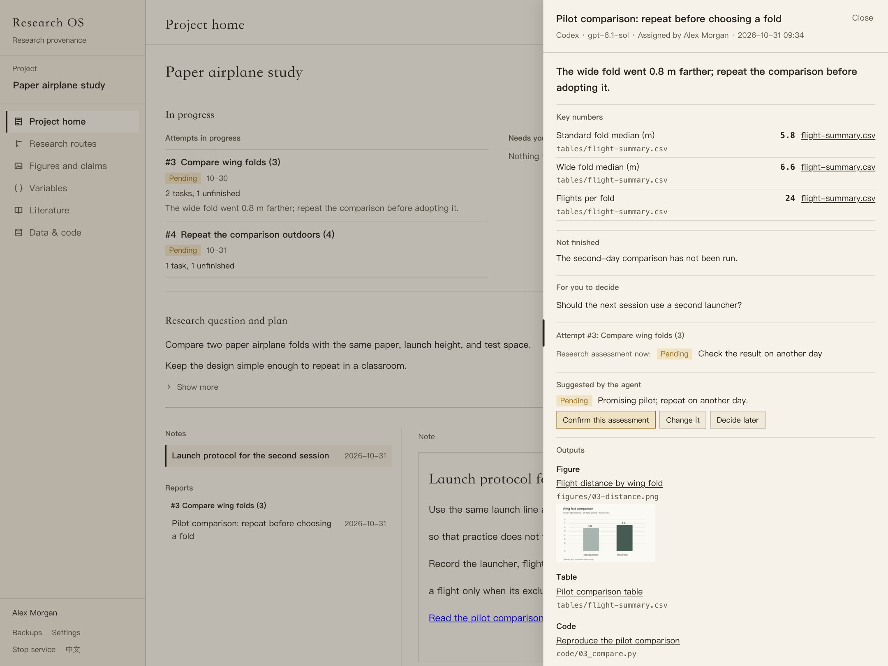
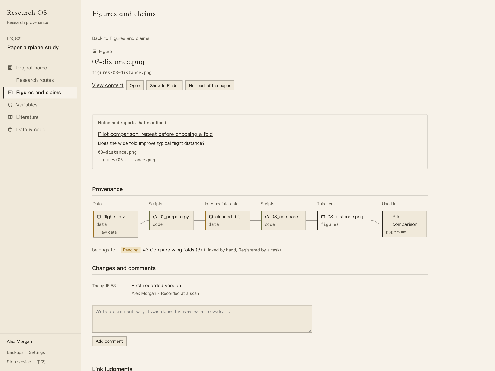

# Research OS

[](https://github.com/LinyingL/research-os/releases/tag/v1.0.0)
[](https://github.com/LinyingL/research-os/actions/workflows/tests.yml)
[](LICENSE)

**A research workspace for people and AI agents.**

Develop a research question, write plans and notes, and keep track of the
attempts that follow. Give an agent a task, review what it hands back, and
keep the report beside the data, code, figures, and references behind it.
Work independently or submit changes for review by your PI.

Research OS runs on your Mac. Your documents and analysis files stay in
your project folder. Continue using Stata, Python, R, or your usual editor;
use Research OS to follow the work and decide what to do next.


*Research OS 1.0.0, English interface. Every screenshot uses a fictional
paper airplane study. Names, references, numbers, and agent handbacks are
demonstration data.*

## Follow a question through the work

Start by writing a question and a plan. Keep notes as your thinking changes.
Record a research attempt when you want to explore a direction, compare a
method, or retain the basis for a decision.

Each attempt can hold tasks for you or an AI agent. The route map and list
show their progress together. Project home brings ongoing attempts and work
awaiting your attention to the top. Writing notes and reports remains
independent of the task list.


An assessment has a status and a separate reason. Keep an abandoned route
and the evidence behind it; record a new reason when your interpretation
changes. An agent can suggest an assessment. A person confirms it.

## Review what an agent hands back

Assign a task to **Codex**, **Claude Code**, **DeepSeek Harness**, or
**OpenCode** installed on your Mac. Choose the model version and, when the
runner supports it, its reasoning effort. Follow progress, answer questions,
and send work back for revision.

A handback brings together the task, the report, key numbers and their
source files, unfinished work, questions, and a suggested assessment.
Open its files, inspect the evidence, and decide whether the attempt should
continue. The next task can use an earlier report and its linked material
as background.



Agents receive the project's output locations. They register their final
files by kind, so figures, tables, code, data, references, and variable
drafts appear in the corresponding views. Each task has a separate process
folder for scratch work. Review unregistered files, inspect a run's changes,
and preview an undo before applying it.

Use **Register…** for files an agent run created and nobody registered,
wherever they lie in the project. Registration keeps the files in place.

## Read the evidence

| View | What it helps you do |
| --- | --- |
| Project home | See current work, write the plan, keep notes, and read reports. |
| Research routes | Follow attempts and their tasks, compare assessments, and retain decisions. |
| Figures and claims | Select the paper, inspect its figures and tables, and follow their sources. |
| Data and code | Browse scripts and datasets and inspect their recorded relationships. |
| Variables | Create definition cards, compare versions, and confirm the definition in use. |
| Literature | Search references, read available abstracts, open PDF attachments, and check citations. |
| Settings | Configure agents, the local drafting model, online lookup, and interface language. |

Click a project-file link in a note or report to open it beside your writing.
Drag the file panel's left edge to give it more space. Markdown opens in
preview; choose **Edit** to write. Word (`.docx`) previews show body text and
tables, with **Open** available for the original layout.



Relationships retain their evidence. A link found in code shows what the
code says; it does not establish that the analysis ran. Missing files and
missing sources remain visible so you can repair them.

The literature library reads BibTeX and CSV/JSON reference exports and
matching metadata from a local Zotero library. Optional DOI lookup checks
Crossref and OpenAlex for missing abstracts and caches them on this Mac.
An unavailable abstract is shown as unavailable. This is an abstract and
reference library; automated online full-text retrieval is not included in
1.0.0.


## Work alone or with a team

A single-person project saves directly. To collaborate, choose **Start
collaborating…** from the project menu. Each member works in a local copy
and sends a proposal through a shared folder, such as OneDrive.

The PI compares the changes, approves them or returns them with a reason,
then publishes the official version. Members sync to receive it. Proposed
changes remain separate until approved. Comments and certain shared records
sync without an individual approval; the
[team guide](docs/install-and-join.en.md) explains the boundaries.

The PI's computer holds the official project. Research OS uses the shared
folder to exchange proposals and snapshots; no collaboration server is
required.

## Install

The native app requires **macOS 12 or later**, Apple's command line tools,
and [uv](https://docs.astral.sh/uv/getting-started/installation/).
The engine and command line require **Python 3.11 or later**.

Install the **1.0.0 release**, including the optional dependency used by AI
agents:

```bash
uv tool install --force --with "mcp<2" git+https://github.com/LinyingL/research-os@v1.0.0
researchos app
```

Open **Research OS.app** from `~/Applications`. Choose **New project…** to
start with a name and save location, or **Add project…** to open an existing
research folder. Importing an old attempt table is optional.

Before updating, save drafts, let active agent tasks finish, and close the
app. Install the update and run `researchos app` to rebuild and open it.
Update every team member to 1.0.0 before using the new task and review views.
Older tasks without an attempt can be grouped under an existing attempt.
Keep a backup before upgrading; undo backups converted by 0.5.0 or later
are not compatible with earlier versions.

For the core app without AI task execution, omit `--with "mcp<2"`.
Source archives and Python packages are available under
[Releases](https://github.com/LinyingL/research-os/releases).

## AI assistance

### Optional: AI agents

Install and authenticate your chosen runner first. Research OS uses that
program's credentials; account access, model availability, and billing
follow its configuration.

| Runner | Setup |
| --- | --- |
| Codex | Sign in with `codex login`. The CLI bundled with the Codex macOS app can also be detected. |
| Claude Code | Sign in through Claude Code's login flow. |
| DeepSeek Harness | Sign in to the official desktop app, or configure its API key. Select the corresponding account or API-key model route. |
| OpenCode | Configure a provider and model in OpenCode. Local models can be served through LM Studio or Ollama. |

Open **Settings** at the foot of the sidebar and add the program and model
under **AI agent**. Select that agent as a task's owner. Full model IDs are
passed to the runner unchanged; supported reasoning levels are offered
separately.

Agents work in the project folder. Research OS records their runs and
checks their outputs. Research assessments, variable confirmation, and PI
approval remain human actions. Review an agent's work before relying on it.

### Draft attempt fields with a local model

Start LM Studio's server and load a model. In **Settings**, open
**Local model (draft with a model)** and set its address and model ID. A usual address is
`http://127.0.0.1:1234/v1`.

In **New attempt**, choose project files and click **Generate draft** for the empty
fields. Review it before saving. Code alone does not prove its results;
include a log or results file when drafting findings. Selected file contents
are sent to the configured model server.

## Files and development

Plans, notes, reports, and analysis files stay in the project. The index,
local history, and retained run backups live under `~/.researchos/`.
Back up both locations if you need their history. Rebuilding an index does
not restore earlier file contents.

The core engine has no required third-party Python dependencies. MCP is an
optional extra for agent task reporting and external integrations.

```bash
git clone https://github.com/LinyingL/research-os.git
cd research-os
python3 -m venv .venv
source .venv/bin/activate
python -m pip install -e ".[dev]"
pytest -q
```

To index an existing project and open the browser interface:

```bash
researchos init /path/to/project
researchos ingest /path/to/project
researchos serve /path/to/project
```

The readers support Python, R, and Stata scripts, Markdown and LaTeX,
bibliographies, and optional git history and MLflow/W&B records. Scanning
reads files without running the analysis. See the
[command-line guide](docs/cli-reference.md) for supported operations.

## Documentation and feedback

- [Project home](docs/project-workspace.md) · [项目首页](docs/项目首页.md)
- [Install and join a team](docs/install-and-join.en.md) · [安装与加入团队](docs/安装与加入团队.md)
- [Changelog](CHANGELOG.md) · [Design](DESIGN.md)
- [Report an issue](https://github.com/LinyingL/research-os/issues)

## License

[MIT](LICENSE). Copyright © 2026 [Linying Li](https://github.com/LinyingL).
