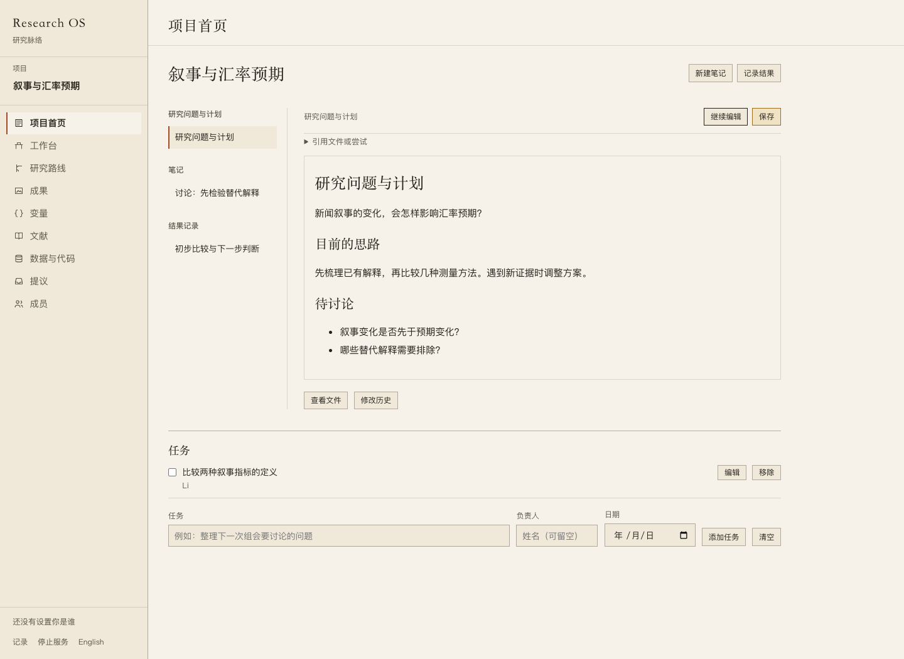
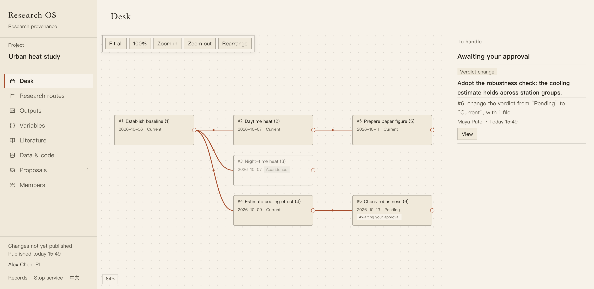
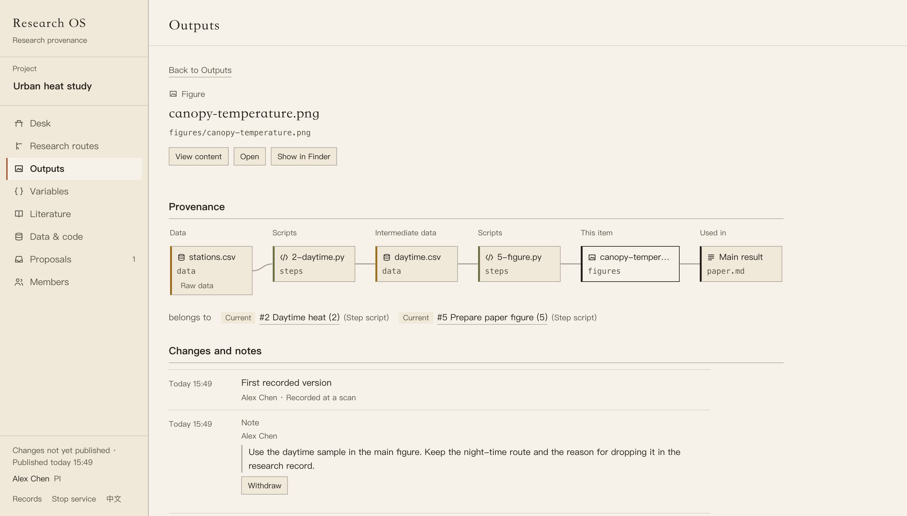
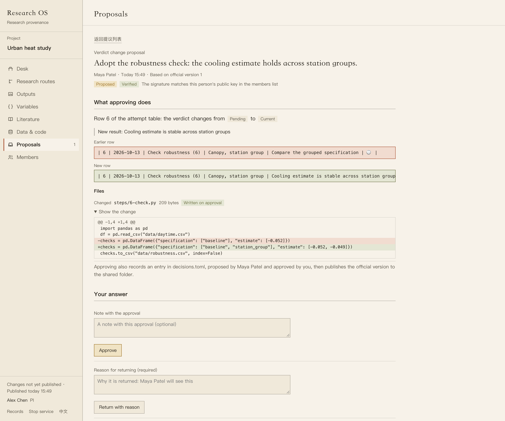

# Research OS

[](https://github.com/LinyingL/research-os/releases/tag/v0.2.0)
[](https://github.com/LinyingL/research-os/actions/workflows/tests.yml)

**A workspace for managing research projects, reviewing team changes, and tracing results back to their evidence.**

Research OS connects research attempts, data, code, figures, drafts, and the
decisions behind them. Use it to keep several projects in view on your own,
or work with a PI and collaborators through a shared folder.

> **Current version: 0.2.0.** This release adds Stata support and local-model
> assistance for new research attempts. Research OS is still an early version;
> start with a backed-up copy of a project.

## New in 0.2.0

- **Stata:** trace the data and figures read or written by `.do` files,
  confirm project folders used by globals, and inspect `.dta` row counts,
  variables, labels and storage types. Scanning reads files; it does not run Stata.
- **Local-model assistance:** choose project files and ask LM Studio, or
  another OpenAI-compatible server, to draft an attempt's description and
  result. Review and edit the draft before saving; verdicts and approval
  decisions remain yours.

See the [release notes](CHANGELOG.md) for details.

## Project writing workspace — in development

The current development branch adds **New project…** and **Project home**.
Start with a name and save location, then write your research question and
plan directly in the app. Add notes, result interpretations and optional
tasks whenever they help; there is no required sequence.

Reference figures, tables and scripts already in the project folder. Code
and analysis stay in Stata or your usual tools. Documents save as Markdown,
with version history and the existing team review workflow.

See [Using project home](docs/project-workspace.md) or
[项目首页使用说明](docs/项目首页.md). These features are not in the published
0.2.0 release yet.

Project home in the development build, using a sample project:



## What it helps you answer

- Where did this figure come from, and which data and scripts are linked to it?
- What did we try, what did we decide, and why was a route abandoned?
- What changed in this file or variable definition, and who approved it?
- Which proposals and judgments need my attention?

For example, open a figure from a paper to inspect its linked scripts, input
data, and research attempt. Open that attempt to see its result, notes, and
decision history. If a relationship could not be extracted, you can add an
attributed link yourself.

## Screenshots

Captured from the running **0.1.0 Demo**, using a sample project with
synthetic data.

**Research routes.** See how attempts branch, which routes were abandoned,
and what is waiting for review.



**Result provenance.** Follow a figure's links to data, scripts, research
attempts, and a paper draft, with its change history and notes below.



**PI review.** Compare proposed result and code changes before approving
them or returning them with a reason.



## Features

| Area | What you can do |
| --- | --- |
| Research routes | Work from a route map, open attempts in a side panel, record results and verdicts, and draw how one attempt grew out of another. |
| Results and evidence | Follow links between figures, drafts, scripts, data, and attempts; see gaps and add missing relationships. |
| Changes and decisions | Inspect text differences, table summaries, notes, and the record of who proposed and approved a change. |
| Team review | Propose attempts, verdict changes, variable definitions, files, and route links; approve, return with a reason, or discuss. |
| Variable definitions | Keep versioned definitions, construction rules, implementation references, and the reasons for adopting a definition. |
| Projects and literature | Switch between projects and connect draft citations to bibliography entries and a local Zotero library. |
| Stata projects | Trace do-file inputs and outputs, resolve macro-based paths, and inspect `.dta` structure without loading its data rows. |
| Model-assisted drafts | Fill empty description and result fields from chosen files, with source and number checks before the draft reaches the form. |

The engine reads existing Python, R and Stata scripts, Markdown and LaTeX drafts,
bibliographies, and optionally git history and MLflow/W&B run logs. A git
repository and an AI assistant are **not required** for the core workflow.

## How collaboration works

1. **Work locally.** Each member edits their own working copy using their
   usual research tools.
2. **Propose a change.** Review what will be sent, add an explanation, and
   submit it through the shared folder.
3. **Review as PI.** Inspect the changes and their context, then approve,
   return with a reason, or leave a discussion note.
4. **Publish and sync.** Approval applies the change to the official project
   and publishes a snapshot. Members sync to receive the accepted version.

An unapproved proposal does not enter the official research record. A
member's local drafts remain visible to that member with their status.
**Single-person projects have no approval step.**

The current approval rules cover research attempts, verdicts, variable
versions, project file changes, and links between attempts. Notes,
judgments on machine-extracted links, and manual file relationships travel
with sync without individual approval.

### Where the files live

| Location | Purpose |
| --- | --- |
| PI's computer | The official project; approved changes are applied here. |
| Shared folder | Published snapshots, proposal files, and the PI's responses. A service such as OneDrive transports them between computers. |
| Member's computer | A local working copy for editing and analysis. |

Research OS manages the proposals, versions, and evidence relationships.
It does not operate a hosted collaboration service or connect to the PI's
computer. Team members need their own shared-folder accounts and the
appropriate folder permissions; no Research OS account is required.

## Install

### macOS app

The desktop app targets **macOS 12 or later**. It is currently installed
from source and built on your Mac, using Apple's command line tools and
`uv`. The installation guides cover these prerequisites and team setup:

- [Installation and joining a team — English](docs/install-and-join.en.md)
- [安装与加入团队 — 中文](docs/安装与加入团队.md)

Once the prerequisites are installed:

```bash
uv tool install git+https://github.com/LinyingL/research-os@v0.2.0
researchos app
```

Open **Research OS.app** from `~/Applications`, then choose **Add project…**
for your own project or **Join a project from the shared folder…** for a
team project. The app previews a project's contents before adding it.

### Command line and development

Requires **Python 3.11 or later**. Install from a checkout:

```bash
git clone --branch v0.2.0 https://github.com/LinyingL/research-os.git
cd research-os
python3 -m venv .venv
source .venv/bin/activate
python -m pip install -e .
```

Initialize and inspect an existing project, replacing the example paths
with your own:

```bash
researchos init /path/to/project
researchos ingest /path/to/project
researchos status --path /path/to/project
researchos trace figure:figures/result.png --path /path/to/project --chain
```

For a browser view, run `researchos serve /path/to/project`. For more
commands, attempt-table configuration, team setup, and optional MCP/model
features, see the [command-line guide](docs/cli-reference.md).

### Optional: local-model assistance

Start LM Studio's local server and load a model. In **New attempt**, open
**Model server**, set the server address (usually `http://127.0.0.1:1234/v1`)
and the model ID shown by LM Studio, then save. Choose up to five text
files from the project and click **Generate draft**.

The draft fills only empty description and result fields. Unsupported
cells stay empty; reading a script is not evidence that it ran. To draft
results, include a text log or results file containing the actual findings.
The form shows which model and files each drafted field used. Nothing is
written until you review and save through the usual workflow.

The default server is on your Mac. If you set an address on another
computer, the selected file contents are sent there; the form shows the
destination before generation. No model is needed for the rest of the app.

## Records and storage

- **Your project** holds its research files and `.researchos/` records:
  identity, configuration, notes, judgments, mappings, variable cards, and
  decisions. The attempt timeline remains in your own Markdown table.
- **Your machine** holds the derived SQLite graph under
  `~/.researchos/graphs/<id>/graph.db`, outside cloud-synced project folders.
  The graph can be rebuilt from the sources and records.
- **Local file history** is stored separately beside the graph, or read
  from git for tracked files. This retained material is not a rebuildable
  cache and needs to be included in backups.
- **Team exchanges** use signed snapshots and proposals, with completion
  markers and content checks. Shared-folder permissions are part of setup.

`researchos records /path/to/project` lists the records and retained
material. `RESEARCHOS_HOME` changes the location of machine-local state.

## Current limits

- **A code relationship is not proof of execution.** Extracted links,
  imported run logs, and author-added relationships have different bases.
  This version does not guarantee a complete, version-pinned record of every
  execution that produced a result.
- **History has limits.** The local history store retains text up to 5 MB;
  larger and binary files are generally represented by fingerprints,
  sizes, and available table summaries. Published team snapshots retain
  file contents separately. A fingerprint alone cannot restore a file.
- **Conflicts need a person.** Research OS does not automatically merge
  two people's edits to the same file. On sync it preserves the local file
  and places the official version beside it for comparison.
- **Platform and language coverage is still growing.** The native desktop
  shell is for macOS. The interface offers Chinese and English, with some
  forms and messages still in Chinese.

## Documentation and feedback

- [Command-line guide](docs/cli-reference.md)
- [Install and join a team](docs/install-and-join.en.md) · [中文指南](docs/安装与加入团队.md)
- [Product and architecture design](DESIGN.md)
- [Report a bug or suggest a change](https://github.com/LinyingL/research-os/issues)

When reporting an issue, include your operating system, the steps to
reproduce it, and what you expected to happen.

## License

[MIT](LICENSE). Copyright © 2026 [Linying Li](https://github.com/LinyingL).
