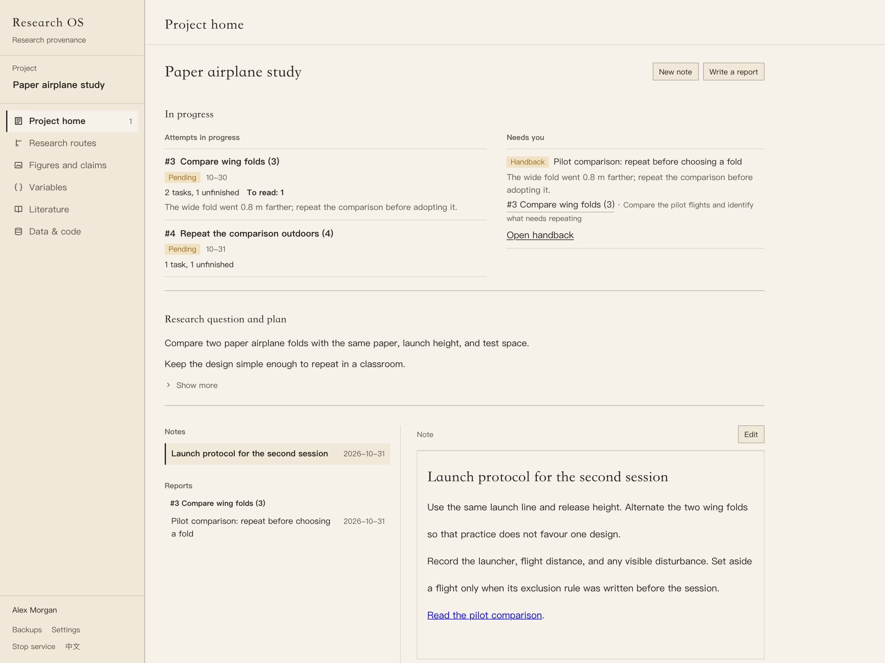
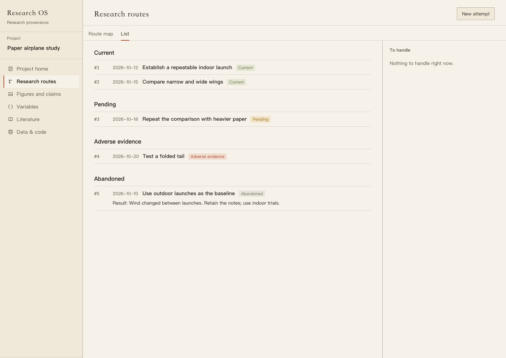
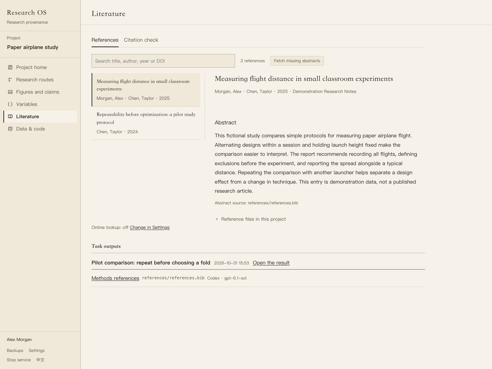
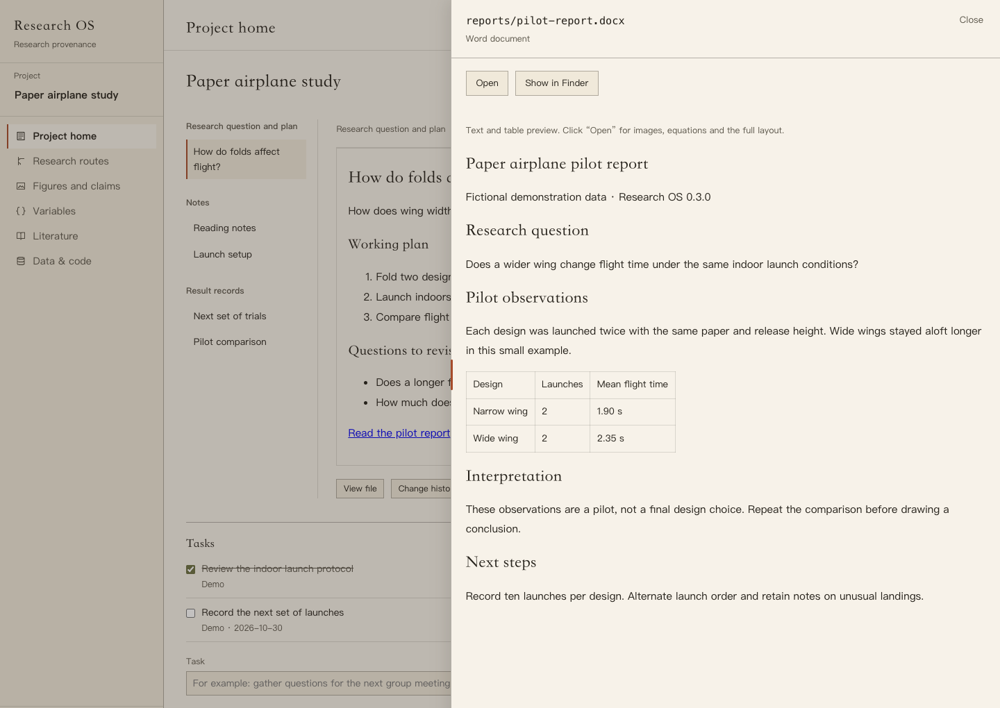

# Research OS

[](CHANGELOG.md#050)
[](https://github.com/LinyingL/research-os/actions/workflows/tests.yml)

**A workspace for research plans, notes, results, and team review.**

Start with a research question. Write a plan, keep notes as ideas develop,
and collect results alongside the data and code behind them. Research OS
keeps this work together across your projects, including the attempts you
set aside and the reasons you recorded.

Write directly in the app and continue using Stata, Python, R, or your
usual editor for analysis. Work on your own or share a project with a PI
and collaborators. Plans, notes, tasks, and research attempts can develop
in whatever order your work needs.



*Research OS 0.3.0, English interface. All screenshots use fictional demo data.*

## Unreleased: research context and handoff

Existing reports in `research/results/` can carry optional research
context alongside their Markdown: the question, method, finding, limits, and
next step. People can edit these fields directly, and AI agents can supply
them when completing a task. Link existing attempts, explicit variable
versions, and project files, with a short purpose for a file when useful.
A task can select an earlier result as background for its next AI run; the
run receives bounded snapshots of the report and the linked variable
definitions, with their version and source paths. It keeps that background separate
from its new findings and can read the full report when needed.

**Record a research attempt…** opens the existing attempt form with suggested
content. Review and save it to create the attempt; a team member submits it
for PI review. Importing a registered variable definition creates a native
variable draft, which still needs its own review and confirmation. Working
alone keeps the existing direct-save workflow.

Reports and their explicit material links travel through the existing
team proposal review. Literature associations currently name project files;
they do not record that an individual DOI supports a finding. These fields
and actions are optional: a note, a manual result, or an ordinary task does
not need to complete a fixed research workflow.

## Version 0.5.0

This version puts the files AI agents leave behind in order: every file has
a place, the app knows which task produced it, and the records Research OS
keeps of each run stay within a limit.

- **A place for every file:** outputs go to the folders set in **Output
  folders**, and each task has its own process folder (`work/<date>-<task
  name>/` by default) for what an agent writes only to carry out the task:
  one-off scripts, check output, downloaded sources and scratch data. Process
  files are not indexed and are not outputs. Agents are told where each kind of
  file belongs, create nothing under `research/`, and hand in one report
  per task.
- **Task outputs:** after every run Research OS sorts the files it created. A
  task's row lists its registered files by kind, says how many new files nobody
  registered, and opens them for review with **Register…**. The process folder
  is shown with its file count.
- **Grouped by task:** Figures and claims, Data & code, Literature and
  Variables show registered files under one heading per task, named after its
  report and dated by the run that produced them. **Open the result**
  opens the report on Project home.
- **Earlier runs:** **Register files from earlier runs…** in **Output folders**
  lists the files that past runs created and nobody registered, each with a
  suggested kind. Files stay where they are, and nothing is registered until
  you confirm. Compressed data such as `.csv.gz` can be registered as data.
- **Reports link their files:** a file path written in a report opens
  that file in its preview.
- **Run storage:** undo backups keep one copy of each content, an undone run
  releases its backup, and a project's run store is kept within 5 GB (1 to 100
  GB). **Space used by runs** shows undo backups, files moved away by undo, and
  run logs; files moved away by undo are deleted only when you choose to.
- **Done marks:** clearing the done mark of a task that already has a result
  asks first.

Update every team member to 0.5.0 before anyone saves output folders or
registers files: earlier versions cannot read the new entries. The first time
a project's runs are cleaned up or **Space used by runs** opens, its existing
undo backups are converted in the background; do not go back to an earlier
version afterwards. See the [changelog](CHANGELOG.md#050) for every change.

## Version 0.3.0

This version adds writing, reference reading, and AI task execution to the
research workspace:

- **Writing:** write plans, notes, and reports as Markdown. Saved
  documents open in preview; click **Edit** to change them and **Save** to
  return to reading. Existing Markdown files in `research/notes/` and
  `research/results/` can be opened and edited too.
- **File reading:** follow links to project files and drag the side panel's
  left edge to give them more room. Preview Word (`.docx`) body text and
  tables, or open the original in its default app.
- **Literature:** browse and search project references with a full abstract
  reading pane. Read local exports and Zotero metadata, or fetch missing
  abstracts by DOI from Crossref and OpenAlex. Retry individual lookups or
  fill missing abstracts in a batch; citation checking has its own tab.
- **One research routes page:** switch between the route map and a grouped
  list. Both open the same attempt panel, with its assessment, results,
  related files, comments, and review actions.
- **A simpler single-person view:** team menus appear when collaboration is
  enabled. Ordinary changes to an existing attempt's assessment and result
  can be saved directly, with undo; abandoning a route still records a reason
  and preserves its basis.
- **AI agents:** assign tasks to Codex, Claude Code, DeepSeek Harness, or
  OpenCode. Select a model version and, where supported, its reasoning
  effort. Follow the run, answer questions, and receive a report.
  Preview the files an undo would affect and choose which changes to keep.
- **Output folders:** keep the project's existing layout and choose where
  new code, data, figures, tables, references, reports, and variable drafts
  belong. Agents report their final files when completing a task; the app
  checks their paths and formats and shows them in the relevant views.

See the [changelog](CHANGELOG.md#030) for the version changes and upgrade notes.

## Everyday work

| Where | What you do |
| --- | --- |
| Project home | Write the research question and plan, keep notes, organize reports, and maintain an optional task list. |
| Research routes | Record attempts, connect directions that grew out of earlier work, and retain the reasons for continuing or abandoning them. |
| Figures and claims | Inspect figures, tables, and quantitative claims in manuscripts, together with the relationships recorded for them. |
| Data and code | Browse scripts and datasets, inspect their inputs and outputs, and follow file relationships. |
| Variables | Keep variable definitions and their versions. |
| Literature | Read project references and abstracts, search titles, authors, years, and DOIs, and check citations separately. |
| Team review | Submit changes from a working copy, compare them as PI, and publish the accepted version. |

A **note** is an editable document. A **comment** is a short, attributed
message attached to a file or research attempt. **Reports** hold
findings and interpretation; **Figures and claims** shows the material
linked from manuscripts.

## Read files and references

### Project files

Insert a file reference while writing, or use a relative Markdown link to
an existing project file. Clicking the link opens the file panel. Drag its
left edge to resize it; the app remembers the width on this device.
Double-click the edge to reset it.

Word (`.docx`) previews show body text and tables. Use **Open** for images,
equations, and the complete Word layout. Files without an in-app preview
can also be opened in their default application or revealed in Finder.

### Literature and abstracts

The **Literature** page separates the reference library from citation
checking. Select a reference to read its title, authors, publication details,
and abstract. The library reads indexed BibTeX files and reference exports
such as `references.csv` and `references.json`, and uses matching DOIs to
add information from a local Zotero library.

For missing abstracts, enable **Look up references online by DOI** in
**Settings** (at the foot of the sidebar; the setting belongs to this Mac, so every
project shares it). Click **Fetch abstract** for one reference or
**Fetch missing abstracts** for the project. Research OS checks Crossref,
then OpenAlex when needed, matches the exact DOI, and shows the abstract's
source. Results are cached on this Mac; opening the library itself makes
no online requests. Online lookup sends DOIs, not manuscript contents.

Coverage depends on the sources. A reference can remain without an
abstract after a successful lookup. **Retry abstract lookup** lets you
check again; a failed request stays distinct from a completed lookup
that found no abstract.

## Install

The native app requires **macOS 12 or later**, Apple's command line tools,
and [uv](https://docs.astral.sh/uv/getting-started/installation/).
The engine and command line require **Python 3.11 or later**.

Install or update from the current source:

```bash
uv tool install --force git+https://github.com/LinyingL/research-os@main
researchos app
```

These commands track `main`. Published tags are listed under
[Releases](https://github.com/LinyingL/research-os/releases).

Open **Research OS.app** from `~/Applications`:

- **New project…** creates a folder and opens the research question and plan.
- **Add project…** opens an existing research folder.
- **Join a project from the shared folder…** joins a team working copy.

New projects start with an empty research record. Importing an old attempt
table is optional. An existing project without an attempt table gets an
empty table and its settings when you first open **New attempt**.

Before updating, save drafts and let any running agent tasks finish. Close
the app, install the update, then run `researchos app` again. This rebuilds
the native app and starts the updated engine. A window opened through a
plain server URL can read the project but cannot save; open it through the
app or `researchos serve`.

### Command line and development

```bash
git clone https://github.com/LinyingL/research-os.git
cd research-os
python3 -m venv .venv
source .venv/bin/activate
python -m pip install -e ".[dev]"
```

To scan an existing project and open its browser interface:

```bash
researchos init /path/to/project
researchos ingest /path/to/project
researchos serve /path/to/project
```

The [command-line guide](docs/cli-reference.md) covers file tracing,
research records, variables, and team commands.

## AI assistance

### Optional: AI agents

Research OS runs **Codex**, **Claude Code**, **DeepSeek Harness**, or **OpenCode** installed on
your Mac. Install and configure your chosen program first, and check that
it works from your terminal. OpenCode can use a local model through LM
Studio or Ollama when configured for that provider.

For Claude Code, sign in through its own login flow. Pro and Max users can
use their Claude subscription; Claude and Claude Code share the plan's
usage limits. See the [official subscription guide](https://support.claude.com/en/articles/11145838-use-claude-code-with-your-pro-or-max-plan).
Claude Code's configured credentials determine subscription or API billing.
Its model picker includes explicit Sonnet, Opus, Haiku, and Fable versions,
such as `claude-sonnet-5-5` and `claude-opus-4-6`. The selected ID is passed
unchanged. Keep Claude Code up to date with `claude update`; supported
versions depend on your account and CLI. Full IDs and dated snapshots can
also be entered manually. See the [Claude model guide](https://support.claude.com/en/articles/11940350-claude-code-model-configuration).
If a run reports an expired OAuth token, sign in again:

```bash
claude auth login --claudeai
```

For Codex, sign in with `codex login`. Research OS also detects the CLI
bundled with the macOS desktop app. It uses Codex's existing authentication;
no API key is required when signing in with ChatGPT. Choose an available full
model ID, such as `gpt-6.1-sol`, from the model version list, or enter an ID
manually. **Refresh models** reloads Codex's catalog. Model access depends on
your account and login method; GPT-5.5 is no longer available with ChatGPT
sign-in, but remains available with API authentication. See the
[Codex model guide](https://learn.chatgpt.com/docs/models).

For [DeepSeek Harness](https://www.deepseek.com/harness/), install the official
desktop app and sign in there. Research OS detects its bundled `dsh` in
`/Applications` or `~/Applications`; installing a separate CLI is optional.
Choose **DeepSeek Harness** in the agent settings, then an **Account** model
to use that sign-in, or an **API Key** model to use the key configured in
Harness. The suggestions include `deepseek-flash` and `deepseek-v4-pro`;
availability depends on your Harness version and account. Custom IDs use
`deepseek-account/<model>` or `deepseek-official/<model>`. Tasks run through
the official headless interface, with progress, replies, reports, and undo
in Research OS. They do not open or control a desktop chat window.
See the [official desktop CLI documentation](https://github.com/deepseek-ai/deepseek-harness/blob/master/apps/desktop/README.md#terminal-command).

Install Research OS with the optional MCP dependency so the agent can
report back:

```bash
uv tool install --force --with "mcp<2" git+https://github.com/LinyingL/research-os@main
researchos app
```

From a checkout, use `python -m pip install -e ".[mcp]"`.

Open **Settings** at the foot of the sidebar (or **Change in Settings** beside
**AI agent** in the task area of **Project home**) and add the program
and model version in its **AI agent** section. Select it as a task's **Owner**, save, and click **Run**. The agent
works in the project folder: it can read files, write code, run analysis,
and write notes. Its completion report is saved as a report linked to
the task.

Use **Output folders** beside **AI agent** to review the project's output
locations. Defaults reuse common existing folders. Saving the settings
keeps files in place and creates no output folders; the agent creates them
as needed. Each run receives its own copy of the locations, so changing
them applies to new runs.

Everything an agent writes only to carry out a task, such as check scripts
and their output, downloaded sources and scratch data, is a process file. It
goes to the task's process folder, `work/<date>-<task name>/` by default, which
the index skips and which does not count as outputs. The agent is told where
each kind of file belongs and that the report is the task's one handback.

When completing a task, the agent lists its final files by type and path.
The app checks that they exist locally, stay within the assigned folder,
and use a supported format. Figures and tables appear under **Figures and
claims**, with image and CSV/TSV previews. Reference exports enter the
**Literature** library with their available abstracts; registered PDFs are
also listed there. Code, data, and reports appear under **Data and code**.
The registered rows stand under one heading per task, which says what the task
is and when its run was. The result
record links to the files, and a file path written in code style in its
preview opens that file.

A task's row shows its files under **Task outputs**. After a run, a count
such as **3 new files not registered** appears when the task's runs created files
nobody registered; **Register…** lists them for review, and **Register files
from earlier runs…** in **Output folders** lists those from before. A file
listed there can be registered wherever it lies, and a registration can be
removed without touching the file. Nothing is moved.

Variable definitions arrive as TOML drafts under **Variables**. Click
**Import as variable draft** to create a native card, or a new draft
version of an existing confirmed card. An open draft is kept for you to
resolve first. Confirmation remains a separate human action. Registering
a file associates it with the task; it does not establish that an analysis
ran or that a research finding is correct.

For supported models, choose **Reasoning effort** separately from the model
version. **Default** uses the runner's configuration. Each run records the
selection and retains it when you reply or send work back.

The initial instruction includes the task, the saved research question
and plan up to 8,000 characters, and the titles and paths of up to 50 notes
and reports. The agent reads further files as needed. Conversations
in the Claude desktop app are not included.

Use **Run log** to follow progress, inspect file changes, and find the agent
program's own session by its **Session ID**. You can stop a run, answer a
question, send completed work back for revision, or preview and undo supported
changes. Research assessments, link confirmation, and team approval stay with
people.

Agent checks restrict changes to existing data and project records, but
are not an operating system sandbox. Claude Code has checks before tool
calls; OpenCode relies on its permissions and the comparison after a run.
Codex runs in its workspace-write sandbox, with changes checked afterward.
Undo keeps copies of files up to 16 MB for the newest 20 runs, stores each
distinct content once, and keeps a project's backups, moved-away files and
logs within 5 GB by default; **Space used by runs** shows what they take. Undo
leaves later edits alone and cannot reverse installed software or changes
outside the project. See the [agent guide](docs/project-workspace.md#let-an-ai-agent-carry-out-a-task)
for the full scope and limits.

Claude Code sends the content it reads to Anthropic. OpenCode uses the
model provider you configure, which may be local.

### Draft attempt fields with a local model

Start LM Studio's local server and load a model. Open **Settings** at the foot
of the sidebar, enter the server address and model ID under **Local model
(draft with a model)**, and save. A usual LM Studio address is
`http://127.0.0.1:1234/v1`.

In **New attempt**, choose up to five project text files and click
**Generate draft**. The model fills empty description and result fields and
identifies their source files. Include a text log or results file to draft
findings; code alone does not show what happened when it ran. Review the
draft before saving. Selected content goes to the server address shown in the
form.

## Work alone or with a team

Single-person projects save directly. To start a team, choose **Start
collaboration…** in the project menu. Team members work in their own local
copies and submit changes through a shared folder:

1. Write in Research OS and run analysis in your usual tools.
2. Select the changes, explain them, and submit a proposal.
3. The PI reviews the differences, approves them or requests revisions.
4. Approved changes enter the official project and are published. Members
   sync to receive them.

An unapproved proposal stays separate from the official version. Research
attempts, assessments, variable versions, project files, and links between
attempts use PI review. Written plans, notes, and reports use the
file review workflow. Comments, link judgments, and manually recorded file
relationships sync without individual approval.

The PI's computer holds the official project. The shared folder carries
snapshots and proposals, transported by a service such as OneDrive.
Research OS does not host a collaboration server.

**Upgrade every team member to 0.5.0 before using agent tasks.** Version
0.2.0 cannot read the result links an agent adds to a task record. The same
goes for process files: update every member before anyone saves output folders
or registers one. A version from before process files cannot read
`research/folders.json` once it lists the process-files location, or a task's
registrations once one of them is a process file.

## Files and research tools

Your written work stays in the project folder:

```text
research/overview.md      Research question and plan
research/notes/           Notes
research/results/         Reports, including agent handbacks
research/tasks.json      Optional tasks
research/folders.json    Output locations, when saved
research/results/*.outputs.json   File registrations beside each task report
.researchos/              Project identity, settings, and research records
```

The file index and retained local history live under `~/.researchos/`,
outside the project. Back up the project and local history together;
rebuilding an index does not restore old file contents. Local history
retains text up to 5 MB; fingerprints and summaries of larger files are
not restorable copies. Team snapshots retain published file contents
separately. Conflicting edits are kept for a person to resolve.

Research OS reads supported Python, R, and Stata scripts, Markdown and
LaTeX manuscripts, bibliographies, and optional git history and MLflow/W&B
experiment records. Stata support includes `.do` inputs and outputs,
resolvable macros, and `.dta` structure; `.ado` files are listed as scripts.
Scanning reads files without running the analysis.

Relationships show the evidence they came from. Imported run records can
provide evidence of execution; a relationship found in code alone does
not establish that it ran. File tracing is limited to the formats and paths
the readers can resolve.

## Screenshots

These views show the 0.3.0 interface with a fictional paper airplane
project. Reference titles, abstracts, measurements, and results are sample data.

<details>
<summary>Research routes, literature abstracts, and Word preview</summary>

**Research routes.** Browse attempts by assessment and retain the recorded
results of abandoned routes.



**Literature.** Search references and read the selected abstract with its source.



**Word preview.** Open a document link and widen the file panel to read body
text and tables beside the project.



</details>

## Documentation and feedback

- [Project home](docs/project-workspace.md) · [项目首页](docs/项目首页.md)
- [Install and join a team](docs/install-and-join.en.md) · [安装与加入团队](docs/安装与加入团队.md)
- [Command-line guide](docs/cli-reference.md)
- [Changelog](CHANGELOG.md) · [Design](DESIGN.md)
- [Report an issue](https://github.com/LinyingL/research-os/issues)

## License

[MIT](LICENSE). Copyright © 2026 [Linying Li](https://github.com/LinyingL).
